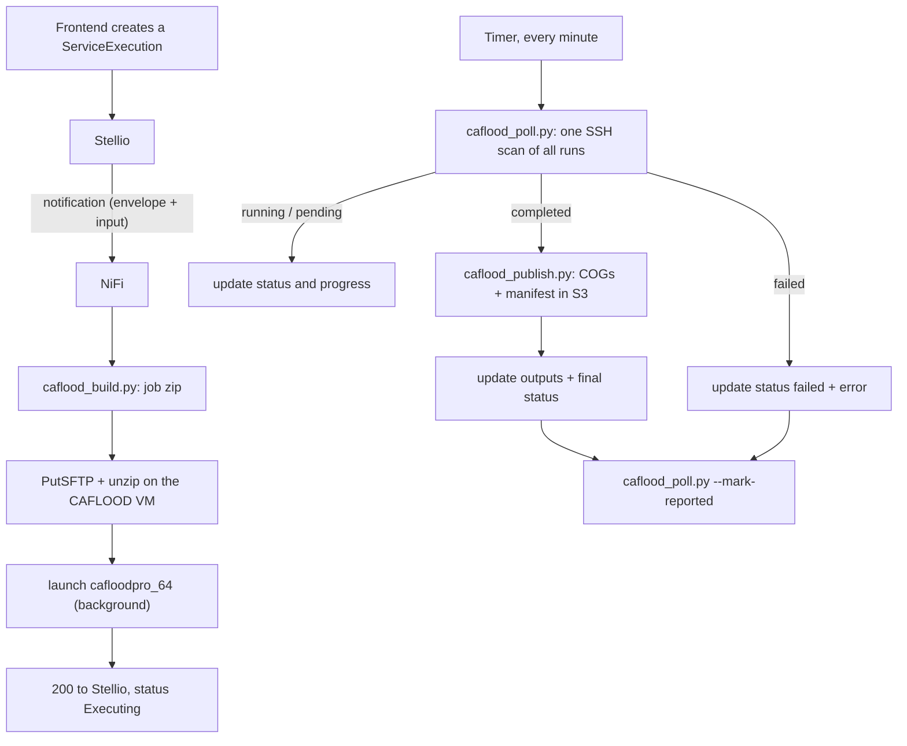

# CAFLOOD service pipeline: reference

How an NGSI-LD `ServiceExecution` in Stellio becomes a CAFLOOD flood
simulation on a remote VM, how its progress is tracked, and how its results
end up in file storage. For a quick start, see [README.md](README.md).

Contents:

1. [Overview](#1-overview)
2. [Entities and payloads](#2-entities-and-payloads)
3. [Step 1: build the job (`caflood_build.py`)](#3-step-1-build-the-job)
4. [Launch on the CAFLOOD VM](#4-launch-on-the-caflood-vm)
5. [Step 2: track runs (`caflood_poll.py`)](#5-step-2-track-runs)
6. [Step 3: publish results (`caflood_publish.py`)](#6-step-3-publish-results)
7. [File storage](#7-file-storage)
8. [Configuration and deployment](#8-configuration-and-deployment)
9. [Tests](#9-tests)
10. [Known gaps and temporary choices](#10-known-gaps-and-temporary-choices)

---

## 1. Overview



| Script                                     | Called by                    | Role                                                                  |
| ------------------------------------------ | ---------------------------- | --------------------------------------------------------------------- |
| `caflood_build.py`                         | NiFi, on each notification   | ServiceExecution → CAFLOOD job folder, zip on stdout                  |
| `caflood_poll.py`                          | NiFi, on a timer             | status of every unreported run (JSON on stdout); `--mark-reported`    |
| `caflood_publish.py`                       | NiFi, for each completed run | outputs → COG GeoTIFFs + manifest in S3                               |
| `caflood_common.py`                        | (library)                    | configuration, Stellio / file-storage clients, SSH to the VM          |
| `caflood_inputs.py`                        | (library)                    | payload, timeframe, DEM grid, reprojection, profiles → forcing events |
| `caflood_setup_files.py`                   | (library)                    | writers for `config.csv` and the event / output CSVs                  |
| `caflood_status.py`                        | (library)                    | state / progress / error of one run folder                            |
| `check_file_storage.py`, `check_inputs.py` | a developer                  | manual checks: S3 round trip, entities readable                       |

The CAFLOOD engine itself (setup file format, outputs, error messages) is
documented with the CAFLOOD distribution, see the
[CADDIES framework page](https://www.exeter.ac.uk/research/centres/cws/resources/caddies/).

---

## 2. Entities and payloads

### 2.1 StudyArea: the DEM

```json
{
  "id": "urn:ngsi-ld:StudyArea:468709aa-1c52-4261-8452-4acdbea0eef1",
  "type": "StudyArea",
  "name": { "type": "Property", "value": "DEM MENTON TEST RMA 2" },
  "operationSpace": {
    "type": "GeoProperty",
    "value": {
      "type": "Polygon",
      "coordinates": [
        [
          [7.41946282, 43.7732883],
          [7.5211894, 43.76911054],
          [7.527626, 43.85037183],
          [7.42575522, 43.85455574],
          [7.41946282, 43.7732883]
        ]
      ]
    }
  },
  "fileSize": { "type": "Property", "value": 52.29, "unitCode": "4L" },
  "resolution": { "type": "Property", "value": 5, "unitCode": "MTR" },
  "digitalElevationModelLinkUrl": {
    "type": "Property",
    "value": "https://<object-store>/urbaquantum-caflood-inputs-dem/9ac32dde-cb98-4c11-8c18-c7ec626a58fc"
  },
  "coordinateReferenceSystem": { "type": "Property", "value": "EPSG:2154" }
}
```

The pipeline reads only two attributes:

- `digitalElevationModelLinkUrl`: an ESRI ASCII Grid (`.asc`), given as the
  object-store URL returned by an upload (see [§7](#7-file-storage)). A local
  path relative to `CAFLOOD_DATA_DIR` also works, for testing.
- `coordinateReferenceSystem`: the CRS of that DEM. An `.asc` file can't
  store it.

`operationSpace`, `fileSize` and `resolution` are for the frontend only and
don't need to match the DEM.

### 2.2 Profiles: forcings for a relative timeframe

A profile is a time series of `{time, value}` breakpoints, in seconds from
the start of the simulation. It has no location: the location is attached
where the profile is selected, on the Relationship inside the
ServiceExecution ([§2.3](#23-serviceexecution-relative-timeframe-implemented)).

```json
{
  "id": "urn:ngsi-ld:InflowProfile:caflood-test-pulse",
  "type": "InflowProfile",
  "name": { "type": "Property", "value": "Short pulse inflow" },
  "profile": {
    "type": "JsonProperty",
    "json": [
      { "time": 0, "inflow": 0 },
      { "time": 60, "inflow": 80 },
      { "time": 180, "inflow": 80 },
      { "time": 240, "inflow": 0 }
    ]
  }
}
```

```json
{
  "id": "urn:ngsi-ld:WaterLevelProfile:caflood-test-constant-tail",
  "type": "WaterLevelProfile",
  "name": { "type": "Property", "value": "Constant tailwater" },
  "profile": {
    "type": "JsonProperty",
    "json": [
      { "timeStop": 0, "waterLevel": 0 },
      { "timeStop": 60, "waterLevel": 30 },
      { "timeStop": 540, "waterLevel": 30 },
      { "timeStop": 600, "waterLevel": 0 }
    ]
  }
}
```

```json
{
  "id": "urn:ngsi-ld:RainfallProfile:caflood-test-burst",
  "type": "RainfallProfile",
  "name": { "type": "Property", "value": "Short intense burst" },
  "profile": {
    "type": "JsonProperty",
    "json": [
      { "timeStop": 0, "rainIntensity": 0 },
      { "timeStop": 60, "rainIntensity": 10 },
      { "timeStop": 120, "rainIntensity": 120 },
      { "timeStop": 180, "rainIntensity": 40 },
      { "timeStop": 300, "rainIntensity": 0 }
    ]
  }
}
```

| Entity type         | CAFLOOD event | Value key(s)                   | Unit                     | Location                       |
| ------------------- | ------------- | ------------------------------ | ------------------------ | ------------------------------ |
| `InflowProfile`     | Inflow        | `inflow` (or `Inflow`)         | m³/s                     | required                       |
| `WaterLevelProfile` | Water level   | `waterDepth` (or `waterLevel`) | m **depth above ground** | required, a Point              |
| `RainfallProfile`   | Rain          | `rainIntensity`                | mm/h                     | optional (none = whole domain) |

- **The entity type decides what a profile is,** not the input field it was
  selected under.
- **Either time key works:** `timeStop` or `time`.
- **Water level values are depths above ground.** CAFLOOD expects an absolute
  water-surface elevation, so the ground elevation of the DEM cell under the
  location is added to every value.
- **An attribute named `zone` on a profile entity is ignored:** only the
  selection's location counts.

### 2.3 ServiceExecution: relative timeframe (implemented)

```json
{
  "id": "urn:ngsi-ld:ServiceExecution:5be89d42-92c2-400b-b788-2fa59396d9bd",
  "type": "ServiceExecution",
  "entityId": "urn:ngsi-ld:StudyArea:468709aa-1c52-4261-8452-4acdbea0eef1",
  "entityType": "StudyArea",
  "serviceName": "CAFLOOD",
  "input": {
    "timeframeControl": { "type": "Property", "value": "relative" },
    "hydraulicForcing": [
      {
        "type": "Relationship",
        "object": "urn:ngsi-ld:InflowProfile:caflood-test-pulse",
        "location": {
          "type": "GeoProperty",
          "value": {
            "type": "Point",
            "coordinates": [7.49407636739582, 43.783989699931396]
          }
        }
      },
      {
        "type": "Relationship",
        "object": "urn:ngsi-ld:WaterLevelProfile:caflood-test-constant-tail",
        "location": {
          "type": "GeoProperty",
          "value": {
            "type": "Point",
            "coordinates": [7.492698993107041, 43.78781016860995]
          }
        }
      }
    ],
    "rainfallForcing": [
      {
        "type": "Relationship",
        "object": "urn:ngsi-ld:RainfallProfile:caflood-test-burst"
      }
    ],
    "initalWaterDepth": { "type": "Property", "value": "Skip" },
    "duration": { "type": "Property", "value": "PT36H" },
    "requestedOutputs": {
      "type": "JsonProperty",
      "json": {
        "rasterSpatialOutputs": {
          "requestedVariables": ["waterDepth", "waterVelocity"],
          "outputRecoringPeriod": 300
        }
      }
    }
  }
}
```

- **Stellio notifies only `input`, not the envelope.** As a workaround, the
  creator copies the two envelope values the pipeline needs into `input`:
  `serviceExecutionId` (the full ServiceExecution id; the creator chooses the
  id, so it's known at creation) and `studyAreaId`. NiFi reads
  `serviceExecutionId` for the run folder name (EvaluateJsonPath
  `$.serviceExecutionId.value`). What NiFi receives:

  ```json
  {
    "serviceExecutionId": {
      "type": "Property",
      "value": "urn:ngsi-ld:ServiceExecution:5be89d42-92c2-400b-b788-2fa59396d9bd"
    },
    "studyAreaId": {
      "type": "Property",
      "value": "urn:ngsi-ld:StudyArea:468709aa-1c52-4261-8452-4acdbea0eef1"
    },
    "timeframeControl": { "type": "Property", "value": "relative" },
    "hydraulicForcing": ["... as above ..."],
    "rainfallForcing": ["... as above ..."],
    "duration": { "type": "Property", "value": "PT36H" },
    "requestedOutputs": {
      "type": "JsonProperty",
      "json": { "...": "as above" }
    }
  }
  ```

  `caflood_build.py` accepts both this and the full envelope, so nothing
  changes if the envelope is notified later. `serviceName` and `entityType`
  aren't used: the endpoint only ever receives CAFLOOD executions.

- **Locations are WGS84** (GeoJSON order: lon, lat), as NGSI-LD requires.
- **A profile can be selected several times,** for example at two
  locations. Each selection becomes its own CAFLOOD event.

### 2.4 ServiceExecution: absolute timeframe (not implemented yet)

```json
{
  "id": "urn:ngsi-ld:ServiceExecution:05d7b096-de03-4034-a3b8-37ac7d7f72ab",
  "type": "ServiceExecution",
  "entityId": "urn:ngsi-ld:StudyArea:ec7bb90b-7131-43f9-8c29-cb5ea871a0af",
  "entityType": "StudyArea",
  "serviceName": "CAFLOOD",
  "input": {
    "timeframeControl": { "type": "Property", "value": "absolute" },
    "hydraulicForcing": [
      {
        "type": "Relationship",
        "object": "urn:ngsi-ld:ControlPoint:caflood-test-south-outlet"
      },
      {
        "type": "Relationship",
        "object": "urn:ngsi-ld:ControlPoint:caflood-test-north-inlet"
      }
    ],
    "rainfallForcing": [
      {
        "type": "Relationship",
        "object": "urn:ngsi-ld:WeatherInformation:caflood-test-menton-grid"
      }
    ],
    "initalWaterDepth": { "type": "Property", "value": "Skip" },
    "timeStart": { "type": "Property", "value": "2026-07-03T22:00:00.000Z" },
    "timeEnd": { "type": "Property", "value": "2026-09-08T22:00:00.000Z" },
    "requestedOutputs": {
      "type": "JsonProperty",
      "json": {
        "rasterSpatialOutputs": {
          "requestedVariables": ["waterDepth", "waterVelocity"],
          "outputRecoringPeriod": 300
        }
      }
    }
  }
}
```

The plan: query the measured or forecast inflow, water level and
precipitation of these entities over `[timeStart, timeEnd]` with temporal
queries, and convert them to the same events. Today the timeframe is parsed,
then `collect_absolute_forcings()` stops with "not implemented yet" (exit 1).

---

## 3. Step 1: build the job

`caflood_build.py` reads the notification (augmented `input`, or the full
envelope, see [§2.3](#23-serviceexecution-relative-timeframe-implemented))
from stdin and writes **only the zip
bytes** to stdout. NiFi's `ExecuteStreamCommand` (Output Destination: Flow
File Content) turns that output directly into the flowfile. Logs go to
stderr. Exit codes: 0 = ok, 1 = input or build error, 2 = bad payload or
configuration.

### 3.1 What happens to each input

| Input                                     | Handling                                                                                                                                                                                                                                                                                                                                                                                 |
| ----------------------------------------- | ---------------------------------------------------------------------------------------------------------------------------------------------------------------------------------------------------------------------------------------------------------------------------------------------------------------------------------------------------------------------------------------- |
| `serviceExecutionId` (envelope: `id`)     | Job folder, zip and CAFLOOD `Short Name` (the output file prefix) use its UUID part. The full id becomes `Simulation Name`. A bare UUID is completed with `urn:ngsi-ld:ServiceExecution:`.                                                                                                                                                                                               |
| `studyAreaId` (envelope: `entityId`)      | StudyArea fetched from Stellio: DEM (fetched through file storage, or copied from a local path) and CRS.                                                                                                                                                                                                                                                                                 |
| `timeframeControl` + `duration`           | `relative`: an ISO-8601 duration (`PT36H`, `P3D`, `P1DT12H`; weeks to seconds, no years or months) gives `Time End`. `absolute`: `timeStart` / `timeEnd`, see [§2.4](#24-serviceexecution-absolute-timeframe-not-implemented-yet).                                                                                                                                                       |
| `hydraulicForcing`, `rainfallForcing`     | Each selection → one event CSV (see [§2.2](#22-profiles-forcings-for-a-relative-timeframe)).                                                                                                                                                                                                                                                                                             |
| Selection `location`                      | WGS84 → StudyArea CRS (pyproj). A **Point** becomes a one-cell `Zone`: centre of the DEM cell, width and height = cell size. CAFLOOD resolves a zone to the cell containing its top-left corner plus `ceil(w/cellsize) × ceil(h/cellsize)` cells. A **Polygon** becomes an `Area` (bounding box). A point outside the DEM is an error. A water-level point on a NODATA cell is an error. |
| `requestedOutputs.rasterSpatialOutputs`   | One raster CSV per variable (`waterDepth` → `WD`, `waterVelocity` → `VEL`), peak + periodic snapshots every `outputRecoringPeriod` s. Without `requestedOutputs`: peak WD + VEL only.                                                                                                                                                                                                    |
| `requestedOutputs.pointMonitoringOutputs` | Supported but unused so far: one time-plot CSV per variable at the `controlPoints`' (reprojected) locations.                                                                                                                                                                                                                                                                             |
| `tuningConfig`                            | Optional (`alpha`, `maxDt`, `minDt`, `maxIteration`, `roughnessGlobal`). Missing keys use `DEFAULT_TUNING`, with a warning. `boundaryElevation` is ignored (with a warning): Boundary Ele is always -10000 (open boundary, see `BOUNDARY_ELE`).                                                                                                                                                                                                                                         |
| `initalWaterDepth`                        | Ignored (CAFLOOD cold start).                                                                                                                                                                                                                                                                                                                                                            |

Fixed settings:

- model `WCA2Dv2`;
- `Update DT` 60 s (CAFLOOD's maximum);
- `Raster VEL Vector, false`: velocity as speed and angle grids instead of a
  CSV point cloud about 6× larger;
- `Raster Decimal Places, 3`;
- console, computation-time and volume-check output enabled.

### 3.2 Job folder (actual output for the ServiceExecution in [§2.3](#23-serviceexecution-relative-timeframe-implemented))

```text
5be89d42-92c2-400b-b788-2fa59396d9bd/        (zipped as 5be89d42-...-2fa59396d9bd.zip)
├── dem.asc
├── inflow_0.csv
├── waterlevel_1.csv
├── rain_2.csv
├── raster_WD.csv
├── raster_VEL.csv
├── config.csv
└── job.json
```

`inflow_0.csv`. The point (7.49408, 43.78399) lands in the Lambert-93 cell
centred on (1061625, 6308625):

```text
Event Name,Short pulse inflow
Inflow (cumecs),0.0,80.0,80.0,0.0
Time (seconds),0.0,60.0,180.0,240.0
Zone (tlx tly w h),1061625.0,6308625.0,5.0,5.0
```

`waterlevel_1.csv`. The ground at that cell is 39.37 m, and the profile
depths of 0 / 30 m are added to it:

```text
Event Name,Constant tailwater
Water Level (m),39.37,69.37,69.37,39.37
Time (seconds),0.0,60.0,540.0,600.0
Zone (tlx tly w h),1061490.0,6309040.0,5.0,5.0
```

`rain_2.csv`. There's no location, so it applies to the whole domain:

```text
Event Name,Short intense burst
Rain Intensity (mm/hr),0.0,10.0,120.0,40.0,0.0
Time Stop (seconds),0.0,60.0,120.0,180.0,300.0
```

`raster_WD.csv` (`raster_VEL.csv` is the same with `VEL`):

```text
Raster Grid Name,WDraster
Physical Variable,WD
Peak,true
Period,300
```

`config.csv`:

```text
Simulation Name,urn:ngsi-ld:ServiceExecution:5be89d42-92c2-400b-b788-2fa59396d9bd
Short Name (for outputs),5be89d42-92c2-400b-b788-2fa59396d9bd
Model Type,WCA2Dv2
Time Start (seconds),0
Time End (seconds),129600.0
Max DT (seconds),5.0
Min DT (seconds),0.1
Update DT (seconds),60.0
Alpha (Fraction DT 0.0-1.0),0.7
Max Iterations,2000000
Roughness Global,0.03
Boundary Ele (Hi/Closed-Lo/Open),-10000.0
Elevation ASCII,dem.asc
Rain Event CSV,rain_2.csv
Inflow Event CSV,inflow_0.csv
Water Level Event CSV,waterlevel_1.csv
Time Plot CSV
Raster Grid CSV,raster_WD.csv,raster_VEL.csv
Raster VEL Vector,false
Raster Decimal Places,3
Output Console,true
Output Computation Time,true
Check Volumes,true
```

`job.json` isn't read by CAFLOOD. `caflood_publish.py` uses it to
georeference the outputs:

```json
{
  "serviceExecutionId": "urn:ngsi-ld:ServiceExecution:5be89d42-92c2-400b-b788-2fa59396d9bd",
  "studyAreaId": "urn:ngsi-ld:StudyArea:468709aa-1c52-4261-8452-4acdbea0eef1",
  "crs": "EPSG:2154",
  "timeEndS": 129600.0
}
```

---

## 4. Launch on the CAFLOOD VM

NiFi processors after `caflood_build.py`. `${serviceExecutionId}` and
`${filename}` are flowfile attributes; on the VM the run folder is named
after the ServiceExecution id. Placeholders: `<key>` / `<known_hosts>` /
`<port>` / `<user>@<caflood-vm>` = the `CAFLOOD_SSH_*` settings,
`<runs_dir>` = `CAFLOOD_RUNS_DIR`, `<caflood>` = the CAFLOOD executable on the VM.

1. **PutSFTP** sends the zip to
   `<runs_dir>/${serviceExecutionId}`.
2. **ExecuteStreamCommand (SSH): unzip.**

   ```text
   -i;<key>;-o;UserKnownHostsFile=<known_hosts>;-p;<port>;<user>@<caflood-vm>;"cd <runs_dir>/${serviceExecutionId} && unzip ${filename} && mkdir output_dir"
   ```

3. **ExecuteStreamCommand (SSH): launch** in the background, recording the
   PID and, at the end, the exit code:

   ```text
   -i;<key>;-o;UserKnownHostsFile=<known_hosts>;-p;<port>;<user>@<caflood-vm>;"cd <runs_dir>/${serviceExecutionId} && ( nohup sh -c '<caflood> -sim . config.csv output_dir > output.log 2>&1 && echo 0 > exit_code || echo $? > exit_code' < /dev/null > /dev/null 2>&1 & echo $! > pid )"
   ```

   - **No `;` in the remote command:** it is `ExecuteStreamCommand`'s
     argument delimiter.
   - **The parentheses** keep `echo $! > pid` inside the run folder.

4. **Respond 200** to Stellio, and set the status to `Executing`.

The run folder then fills up with `pid` (right away), `output.log` (CAFLOOD's
stdout and stderr), `output_dir/` (results) and finally `exit_code`.

---

## 5. Step 2: track runs

### 5.1 Scan

`caflood_poll.py`, run by an **ExecuteProcess** every minute, makes **one SSH
call** whatever the number of runs. It reads every folder under
`CAFLOOD_RUNS_DIR` that has a `config.csv` and no `reported` marker, and
prints a JSON array with one entry per run, saying what NiFi should do next:

```json
[
  {
    "folder": "urn:ngsi-ld:ServiceExecution:5be89d42-92c2-400b-b788-2fa59396d9bd",
    "serviceExecutionId": "urn:ngsi-ld:ServiceExecution:5be89d42-92c2-400b-b788-2fa59396d9bd",
    "action": "update",
    "update": { "executionStatus": "executing", "progress": 0.4684 },
    "detail": {
      "state": "running",
      "phase": "simulation",
      "progress": 0.4684,
      "simulationTimeS": 63900.0,
      "timeEndS": 129600.0
    }
  }
]
```

**`update` is the exact body to PATCH** on the ServiceExecution. It only ever
contains the three keys the broker accepts:

| Key               | Values                                                                                                                                                  |
| ----------------- | ------------------------------------------------------------------------------------------------------------------------------------------------------- |
| `executionStatus` | `executing`, `success` or `failure` (`pending` and `cancelled` are never produced)                                                                      |
| `progress`        | 0 to 1                                                                                                                                                  |
| `output`          | present only when there's something to say: `warnings`, or `error` + `exitCode` on failure, or the results on success ([§6](#6-step-3-publish-results)) |

No key ever has a null value: the broker refuses nulls. `detail` holds the
full run status (see [§5.2](#52-how-the-state-is-decided-caflood_statuspy)),
for logs and provenance only, and isn't sent to the broker.

| `action`   | Run state                                        | NiFi does                                                                                              |
| ---------- | ------------------------------------------------ | ------------------------------------------------------------------------------------------------------ |
| `update`   | pending, running                                 | PATCH `update`                                                                                         |
| `finalize` | failed, or completed with a saved publish result | PATCH `update` → `caflood_poll.py --mark-reported ${folder}`                                           |
| `publish`  | completed, not published yet                     | `caflood_publish.py ${folder}`: its output is a `finalize` object → PATCH `update` → `--mark-reported` |
| `wait`     | completed, being published (fresh claim)         | nothing                                                                                                |
| `orphaned` | its ServiceExecution is gone from the broker     | nothing: the poller already stopped the run and marked it (see below)                                  |
| `ignore`   | unreadable folder                                | nothing (`detail.error` says why)                                                                      |

NiFi flow:

```
[1] ExecuteProcess        python caflood_poll.py                   (timer: 1 min)
[2] SplitJson             $.*                                       one flowfile per run
[3] EvaluateJsonPath      action = $.action, folder = $.folder      (to attributes)
[4] RouteOnAttribute      ${action}
      update   → [6]
      finalize → [6] → (on success) [7]
      publish  → [5] → exit 0: back to [3] (its output is a finalize object)
                       exit 1: drop (retried at a later poll)
      wait, orphaned, ignore → drop
[5] ExecuteStreamCommand  python caflood_publish.py ${folder}
[6] EvaluateJsonPath      $.update (Destination: flowfile-content) → PATCH the ServiceExecution
                          (Content-Type: application/json)
[7] ExecuteStreamCommand  python caflood_poll.py --mark-reported ${folder}
```

The content after [2] is the whole entry. Stellio's body is only `update`,
hence the `$.update` → flowfile-content step just before the PATCH.

`update` while running:

```json
{ "executionStatus": "executing", "progress": 0.4684 }
```

`update` when CAFLOOD failed:

```json
{
  "executionStatus": "failure",
  "progress": 0,
  "output": {
    "error": "Error opening CSV file: ./inflow_0.csv | Error reading Inflow Event CSV file: inflow_0.csv",
    "exitCode": 1
  }
}
```

A run that's still unzipped and not launched yet (`pending`) is reported as
`executing` at progress 0, because NiFi launches it right away.

**Only mark a run once its update has succeeded.** A run without a marker
is listed again on the next poll, which acts as an automatic retry. Once
marked, it's never listed again.

**Orphaned runs.** The poller looks up each listed run's ServiceExecution
(`GET /services/<id>`). On a 404, the run would otherwise be PATCHed, and
fail with 404, at every poll forever. This happens when the execution was
deleted, or when NiFi unzipped a run but then answered Stellio with an
error. The poller then, in one extra SSH call:

1. stops the CAFLOOD process if it's still running (only if `pid` still
   runs a `cafloodpro` command line);
2. marks the folder `reported`, so the normal cleanup removes it.

It returns `orphaned`, which NiFi drops. Any other answer (network error,
5xx, token failure) changes nothing, so a broker outage never stops a run.
If the SSH call fails, the entry becomes `ignore` and the next poll
retries. The lookup uses the `STELLIO_*` settings; without them it's
skipped, with a warning on stderr.

`caflood_poll.py --abandon <folder> [<folder> …]` does the same on demand,
for example before deleting a running ServiceExecution. It prints the
folders it marked.

### 5.2 How the state is decided (`caflood_status.py`)

| Run folder contents              | `state`                                                                                                         |
| -------------------------------- | --------------------------------------------------------------------------------------------------------------- |
| no `pid`, no `exit_code`, no log | `pending` (unzipped, not launched yet)                                                                          |
| `exit_code` = 0                  | `completed`                                                                                                     |
| `exit_code` ≠ 0                  | `failed`: CAFLOOD's error lines, or the signal (137 = killed / out of memory, 139 = segfault, 143 = terminated) |
| no `exit_code`, `pid` alive      | `running`                                                                                                       |
| no `exit_code`, `pid` dead       | `failed` ("no longer running but did not write an exit code": killed, VM reboot…)                               |
| no `pid` at all                  | launched before this contract: inferred from the log only                                                       |

**Progress** is read from the last 64 KB of `output.log`:

- **Simulation (0 → 0.95):** the last `Simulation time (MIN) = X` line, as
  `X·60 / Time End`. `Time End` is rounded up to a multiple of `Update DT`,
  as CAFLOOD does.
- **Post-processing (0.95 → 1.0):** the time stamp of the last `Write Raster
Grid: …_<t>` line, divided by `Time End`. CAFLOOD writes the snapshots in
  time order.

`phase` is one of `preprocessing`, `simulation`, `postprocessing`, `done`.
`code` is CAFLOOD's quality flag: 0 = flood contained, 2 = touches DEM
NODATA, 4 = reaches the domain edge. It's
read with a `grep` over the whole log, because post-processing output can
push it out of the tail.

**Errors** are CAFLOOD's own lines: on failure it prints to stderr (which
goes to `output.log`) and returns `EXIT_FAILURE`. For example:

```text
Error opening CSV file: ./inflow_0.csv
Error reading Inflow Event CSV file: inflow_0.csv
Error reading 'Max DT' element
std::bad_alloc        <- any exception text, followed by:
Simulation stopped
```

`error` joins them with `|`. When there are none, it gives the known reason
plus the last log lines.

### 5.3 Run folder lifecycle and cleanup

`python caflood_poll.py --mark-reported <folder>` creates `<folder>/reported`.
Folder names with characters outside `[A-Za-z0-9_.:-]` are refused.

Reported folders are cleaned up by the following scans, with no extra NiFi
step:

| When                                                   | What is deleted                                                                     |
| ------------------------------------------------------ | ----------------------------------------------------------------------------------- |
| next scan after `--mark-reported`                      | everything except `output.log` and `reported` (zip, inputs, `output_dir`, results…) |
| `reported` older than `CAFLOOD_LOG_RETENTION_DAYS` (7) | the whole folder                                                                    |

The inputs, outputs and results can all be regenerated with the wrapper,
and the results are already in S3 and Stellio by then. Only `output.log` is
kept, to debug a run after it has been reported. Folders with neither
`config.csv` nor `reported` are never touched. A missing `CAFLOOD_RUNS_DIR`
is created by the scan, and an empty one gives `[]`.

The scan script is fed to `sh -s` on stdin rather than run by the VM user's
login shell (zsh), where a `*/` that matches nothing is a fatal error
("no matches found", #8246 (status polling zsh glob error)).

**One `CAFLOOD_RUNS_DIR` per tenant/deployment:** a poller handles (and
cleans up) every run in its folder, so two deployments sharing one folder
would PATCH each other's ServiceExecutions on the wrong broker. Use the
same folder in the NiFi upload/unzip/launch commands ([§4](#4-launch-on-the-caflood-vm)).

Old folders from before this mechanism can be marked by hand on the VM. They
are then stripped at the next poll:

```bash
cd <runs_dir> && for d in */; do touch "$d/reported"; done
```

---

## 6. Step 3: publish results

`python caflood_publish.py <folder>`:

1. **Fetch:** pulls `output_dir/*.asc|*.csv`, without the `*_A_*` angle
   grids, plus `config.csv`, `job.json` and the `CODE:` line of `output.log`,
   as one gzipped tar over SSH.
2. **Convert** every raster to a **Cloud-Optimised GeoTIFF**, with the CRS
   from `job.json`:

   | CAFLOOD file                               | Published as                                                                                                                                                           |
   | ------------------------------------------ | ---------------------------------------------------------------------------------------------------------------------------------------------------------------------- |
   | `<short>_raster_WD_<t>` / `_WD_PEAK`       | water depth, uint16 with scale 0.001 (mm), nodata 0                                                                                                                    |
   | `<short>_raster_VEL_V_<t>` / `_VEL_V_PEAK` | speed, uint16 with scale 0.001 (mm/s), nodata 0                                                                                                                        |
   | `<short>_TemporalOut_TIME`                 | **flood arrival time**: simulation time (s) at which each cell first got wet (`timeToThreshold.ca`; _not_ the time of the peak, whatever the engine doc says), float32 |
   | `<short>_points_<VAR>.csv.csv`             | point time series, uploaded as-is                                                                                                                                      |
   | `*_A_*`                                    | velocity angles, skipped                                                                                                                                               |

   GDAL, QGIS and geotiff.js apply the scale, so they read real m and m/s.
   On real Menton outputs, a frame drops from 1,984 KB (`.asc`) to 86–205 KB.

3. **Upload** everything to `FILE_STORAGE_OUTPUT_BUCKET`, 6 at a time, then
   the manifest.
4. **Print** a `finalize` object, shaped like the poller's, which NiFi
   PATCHes before marking the run. The same update is saved in the run folder
   (`publish_result.json`), see below.

Output on success (abridged; URLs are illustrative):

```json
{
  "folder": "urn:ngsi-ld:ServiceExecution:5be89d42-92c2-400b-b788-2fa59396d9bd",
  "serviceExecutionId": "urn:ngsi-ld:ServiceExecution:5be89d42-92c2-400b-b788-2fa59396d9bd",
  "action": "finalize",
  "update": {
    "executionStatus": "success",
    "progress": 1,
    "output": {
      "manifestUrl": "https://<object-store>/urbaquantum-caflood-outputs-rasters/0694...",
      "manifest": {
        "serviceExecutionId": "urn:ngsi-ld:ServiceExecution:5be89d42-92c2-400b-b788-2fa59396d9bd",
        "studyAreaId": "urn:ngsi-ld:StudyArea:468709aa-1c52-4261-8452-4acdbea0eef1",
        "crs": "EPSG:2154",
        "bounds": [1060797.5, 6307112.5, 1062222.5, 6311072.5],
        "boundsWgs84": [7.4827675, 43.7701059, 7.5032373, 43.8064125],
        "cornersWgs84": [
          [7.4855595, 43.8064125],
          [7.5032373, 43.8056831],
          [7.5004344, 43.7701059],
          [7.4827675, 43.7708349]
        ],
        "timeEndS": 129600.0,
        "format": "COG GeoTIFF, uint16 with scale 0.001 (m, m/s) and nodata 0, except floodArrivalTime (float32, seconds)",
        "variables": {
          "waterDepth": {
            "unit": "m",
            "peak": "https://.../3f1c...",
            "frames": [
              { "t": 300.0, "url": "https://.../0b7a..." },
              { "t": 600.0, "url": "https://.../5e44..." }
            ]
          },
          "waterVelocity": {
            "unit": "m/s",
            "peak": "https://...",
            "frames": [{ "t": 300.0, "url": "https://..." }]
          },
          "floodArrivalTime": { "unit": "s", "url": "https://..." }
        }
      },
      "qualityCode": 4,
      "warnings": [
        "CAFLOOD quality code 4: the flood reaches the edge of the domain - results near the edges are unreliable"
      ]
    }
  }
}
```

- `cornersWgs84` runs clockwise from the top-left: the order MapLibre's
  `image` sources expect.
- `timeSeries` is present only if point outputs were requested.
- `qualityCode` is CAFLOOD's `CODE:`. When it's 1, 2 or 4, a readable warning
  explains it.
- Other warnings: no `CODE:` found, or output files that weren't recognised
  and weren't published.

Objects are named with random UUIDs, so **the manifest is the only index**
of a run's results.

**Bookkeeping in the run folder** (on the CAFLOOD VM):

| File                    | Written when                                        | Effect on the poller                                                                                               |
| ----------------------- | --------------------------------------------------- | ------------------------------------------------------------------------------------------------------------------ |
| `publishing`            | publishing starts; removed on failure or at the end | while less than 1 h old: `wait`, so a slow publish isn't started twice. Older (crashed publisher): `publish` again |
| `publish_result.json`   | success, or when giving up                          | re-sent as `finalize` without publishing again, e.g. when the PATCH failed                                         |
| `publish_failures.json` | each failed attempt (`first` time, `attempts`)      | none; the publisher uses it to decide when to give up                                                              |

**Failures** (SSH, conversion, upload, anything): the objects already
uploaded by that attempt are deleted, the attempt is counted and the claim
released.

- **For the first hour of failures:** exit 1, nothing on stdout. NiFi does
  nothing, and the next poll retries (about once a minute).
- **Once publishing has kept failing for 1 hour:** exit 0 with a `finalize`
  object, so the run is closed instead of retried forever:

  ```json
  {
    "executionStatus": "failure",
    "progress": 1,
    "output": {
      "error": "Publishing the results kept failing for 61 min (58 attempts): upload: HTTP 500 (...)"
    }
  }
  ```

A temporary outage (storage endpoint, network, Keycloak) is therefore
absorbed for up to an hour; a permanent problem (file over the size limit,
damaged outputs) ends as a reported failure.

Exit codes: 0 = a `finalize` object was printed (success, or failure after
1 h), 1 = failed attempt (retry), 2 = bad usage or configuration.

---

## 7. File storage

S3 buckets behind **one NiFi HTTP endpoint**, routed on the HTTP method.
Each deployment uses the endpoint that trusts its broker's Keycloak realm
(`FILE_STORAGE_URL`, authenticated with the `STELLIO_*` credentials).

The S3 processors of the flow may need **Use Path Style Access = true** when
virtual-hosted bucket names (`<bucket>.<object-store>`) don't resolve. After
importing a new flow version, re-enter the S3 secret key (NiFi doesn't carry
sensitive values over).

| Method                              | Request                    | Response                                                             |
| ----------------------------------- | -------------------------- | -------------------------------------------------------------------- |
| `POST ?bucket=<bucket>`             | raw file bytes as the body | `{"s3.url": "https://<object-store>/<bucket>/<uuid>"}`              |
| `GET ?bucket=<bucket>&id=<uuid>`    |                            | the file (500 if the object doesn't exist)                           |
| `DELETE ?bucket=<bucket>&id=<uuid>` |                            | `{"status": "success"}`                                              |

Buckets: `urbaquantum-caflood-inputs-dem` (DEMs) and
`urbaquantum-caflood-outputs-rasters` (results). Both endpoints write to the
same object store.

- **Auth:** `Authorization: Bearer <token>`. NiFi (`auth.groovy`) checks the
  RS256 signature against the realm behind its `kcIssuerUrl`, the exact `iss`,
  and the presence of `sub`/`iat`/`exp`/`jti`. There's no audience or role
  check: any client of that realm works. No token gives 401.
- **`id` is the bare key** (the UUID). `FileStorageClient.fetch()` /
  `delete()` accept the full `s3.url` too and keep the last path segment.
- **The object store itself is private** (403 on a direct GET): always go
  through the endpoint.
- **Uploads are limited to about 1 MiB.** On the dev endpoint, 1,000,000
  bytes works but 1,048,576 fails with a 500 that echoes the body back. That
  looks like a 1 MB processor buffer in the NiFi flow. (The urbaquantum route
  used to return an nginx 413 at the same size.) That's enough for COG frames
  but not for most DEMs.
- **On failure, NiFi echoes the request body back** instead of an error
  message (401, 500). The client replaces it with a short, ASCII-safe excerpt
  and a hint.

`python check_file_storage.py <file>` uploads, fetches, compares and deletes
(`--keep` to keep the object). It prints the token's `iss` first.
`--fetch-only` and `--delete` act on an existing object.

---

## 8. Configuration and deployment

All settings come from environment variables, completed by a `.env` next to
the scripts (`$CAFLOOD_ENV_FILE` takes priority). Never put secrets in NiFi
arguments. The full list is in `caflood_common.py`'s docstring and
`.env.example`:

| Group        | Variables                                                                                                                                                                                      |
| ------------ | ---------------------------------------------------------------------------------------------------------------------------------------------------------------------------------------------- |
| Stellio      | `STELLIO_BASE_URL`, `STELLIO_TOKEN_URL`, `STELLIO_CLIENT_ID`, `STELLIO_CLIENT_SECRET`, `STELLIO_CONTEXT_URL`, `STELLIO_TENANT`                                                                 |
| File storage | `FILE_STORAGE_URL` (authenticated with the `STELLIO_*` client), `FILE_STORAGE_OUTPUT_BUCKET`                                                |
| Build        | `CAFLOOD_WORK_DIR`, `CAFLOOD_DATA_DIR`                                                                                                                                                         |
| CAFLOOD VM   | `CAFLOOD_SSH_TARGET`, `CAFLOOD_SSH_PORT`, `CAFLOOD_SSH_KEY`, `CAFLOOD_SSH_KNOWN_HOSTS`, `CAFLOOD_RUNS_DIR`, `CAFLOOD_LOG_RETENTION_DAYS` (default 7), `CAFLOOD_SSH_MULTIPLEX` (default 1), `CAFLOOD_SSH_CONTROL_DIR` (default: temp dir) |

Deployment on the NiFi machine: one clone of this repo per deployment (e.g.
`<scripts_dir>/<deployment>/caflood-wrapper/`), each with its own `.env`.
Updating is a `git pull` there; NiFi picks it up at the next call.

```bash
python3 -m venv .venv && .venv/bin/pip install -r requirements.txt   # requests, pyproj, rasterio (ships GDAL)
cp .env.example .env   # then fill in the secrets
```

| NiFi processor                            | Command                                                       |
| ----------------------------------------- | ------------------------------------------------------------- |
| ExecuteStreamCommand (on notification)    | `.venv/bin/python3 caflood_build.py` (stdin = flowfile)       |
| ExecuteProcess (timer, 1 min)             | `.venv/bin/python3 caflood_poll.py`                           |
| ExecuteStreamCommand (completed runs)     | `.venv/bin/python3 caflood_publish.py ${folder}`              |
| ExecuteStreamCommand (after final update) | `.venv/bin/python3 caflood_poll.py --mark-reported ${folder}` |

The CAFLOOD VM needs only the engine. Nothing is installed there: the status
parsing and the COG conversion both run on NiFi. The NiFi machine needs
Python 3 and the `ssh` command (`openssh-client`; no SSH server).

**SSH connections.** The CAFLOOD VM rejects too many new SSH connections in a
short time ("Connection refused"; a publish followed by `--mark-reported`
used to open 6 within seconds). The scripts therefore share one connection:
OpenSSH multiplexing (`ControlMaster=auto`, socket
`<CAFLOOD_SSH_CONTROL_DIR>/caflood-ssh-%C`, kept for 60 s after its last use).
Set `CAFLOOD_SSH_MULTIPLEX=0` to disable it. The two SSH commands in the
launch flow ([§4](#4-launch-on-the-caflood-vm)) can join the same shared
connection by adding
`-o;ControlMaster=auto;-o;ControlPath=/tmp/caflood-ssh-%C;-o;ControlPersist=60;`
to their arguments, before `-p;<port>`.

---

## 9. Tests

```bash
pip install -r requirements-dev.txt
python -m pytest tests
```

117 offline tests, a few seconds. No network, VM or example files: the
fixtures (`tests/conftest.py`) generate a 20 × 10-cell Lambert-93 DEM near
Menton, a CAFLOOD log in the real format, and run folders and output
rasters. Stellio and S3 are replaced by fakes. They cover:

- both payload shapes, input resolution, ISO durations, timeframes;
- point → one-cell zone, polygon → area, water depth + ground elevation;
- the whole job folder and `config.csv`;
- every status scenario and the progress values;
- poll actions and broker update bodies (no nulls);
- scan and marking, including unsafe folder names;
- orphaned runs: 404 → stopped and marked, unknown answers change nothing,
  a failed clean-up becomes `ignore`; the broker lookup itself
  (stopping a real process needs Linux `ps` / `pkill`: skipped elsewhere);
- COG content, the manifest, quality code warnings;
- publishing bookkeeping: claim / wait, saved result, giving up after 1 h;
- the file-storage client (method routing, bare key, error messages);
- SSH helpers (shared connection options, stderr handling).

They don't cover the real SSH, Stellio and S3 calls. For those, use the
`check_*` scripts and one real run.

---

## 10. Known gaps and temporary choices

- **Absolute timeframe** (ControlPoint / WeatherInformation temporal
  queries) isn't implemented ([§2.4](#24-serviceexecution-absolute-timeframe-not-implemented-yet)).
- **Dev platform:** entities, the wrapper's NiFi and file storage all use
  the dev platform (one set of `STELLIO_*` credentials). Production will move to
  the target platform: broker, tenant, `FILE_STORAGE_URL` and its realm.
- **No `tuningConfig` in current payloads:** every run uses `DEFAULT_TUNING`
  (roughness 0.03). Boundary Ele is always -10000 (open boundary).
- **Final PATCH retries have no cap:** if a `finalize` can never be PATCHed
  (e.g. the ServiceExecution was deleted), it's re-sent at every poll.
- **Number of snapshots** = `Time End / outputRecoringPeriod` per variable
  (432 for 36 h every 300 s). The frontend should limit it.
- **~1 MiB upload limit** on the file-storage endpoint, see [§7](#7-file-storage).
- **`initalWaterDepth`** is ignored (cold start).
- **`ServiceExecution` discovery** isn't available on the broker, which is
  why runs are found by scanning the VM folders rather than by querying for
  `Executing` executions.
